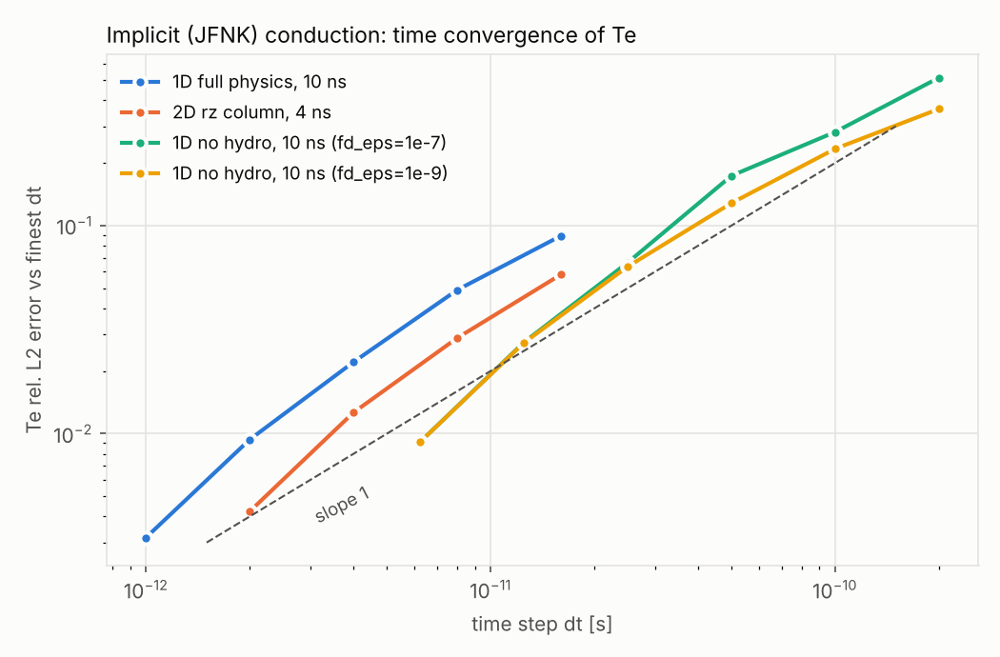
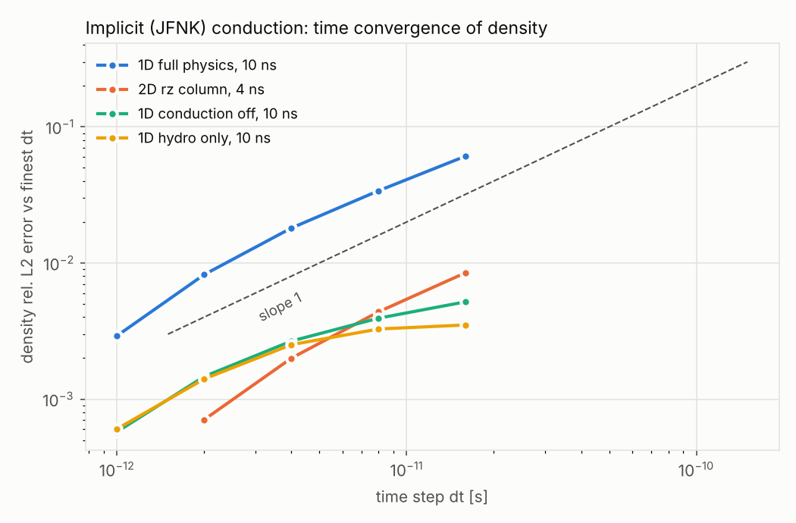

# Time convergence and reproducibility of the implicit (JFNK) conduction scheme

Verification of the backward-Euler JFNK electron thermal diffusion
(`sim_folder/build/thd_jfnk.H`, `thd_diffusion.mode = implicit`,
`castro.diffuse_temp = 0`) on a simple H plasma expansion
(27 eV super-Gaussian Te, ionized core, rho = 1.67e-6 g/cm^3, DESY/COMSOL-like profile),
in 1D cylindrical (r) and 2D rz geometry. Two-temperature build
(`EOS_DIR=gamma_law_2T`), Castro `2T_25.10`.

## How to run

```bash
cd sim_folder/build
make -j4 EOS_DIR=gamma_law_2T DIM=1 USE_MPI=TRUE
make -j4 EOS_DIR=gamma_law_2T DIM=2 USE_MPI=TRUE
cd ../../tests/verification
./run_1d_study.sh            # 1D dt sweeps (~10 min on 4 cores)
./run_2d_study.sh            # 2D rz: z-uniform vs 1D, finite column dt sweep (~10 min)
FCOMPARE=<amrex>/Tools/Plotfile/fcompare.gnu.ex MPIRUN=mpirun ./run_reproducibility.sh
python plot_convergence.py time_convergence_Te.png "1D full physics=work/res_h1d.json" ...
python plot_convergence.py --qty=rho time_convergence_rho.png "1D full physics=work/res_h1d.json" ...
python density_front.py work/runs/h1d_dt      # shock-front radius / peak density vs dt
```

`run_2d_study.sh` compares against `h1d_dt2e-12` from `run_1d_study.sh`, so run
the 1D study first. Check that the logs say
`MPI initialized with N MPI processes` for N > 1: with a launcher/library mismatch
(e.g. the Ubuntu 24.04 MPICH package, which needs a PMIx launcher), `mpirun -np N`
silently starts N independent serial runs.

Method:

* **Time convergence.** Fixed grid (no AMR: 256 cells in 1D, 64x64 in 2D) and
  fixed dt (`castro.fixed_dt`; Castro still shrinks the very first step by
  `init_shrink`), halved repeatedly. Fields Te, rho, f = E_h/E, ionization fraction
  and v_r are compared at exact output times
  (`castro.plot_per_is_exact = 1`) using an r-weighted (cylindrical volume) relative L2 norm,
  1. against the finest-dt run, and
  2. between successive dt, giving the observed order p = log2(d_k / d_{k+1}),
     which does not depend on the reference.
* **Reproducibility.** A production-like setup (AMR `max_level = 2`, adaptive CFL dt)
  run twice, with the solver cache on and off, on 1/2/4 MPI ranks, and with
  tighter Newton/GMRES tolerances. All AMR levels are compared with `fcompare`.

Raw tables are in `results/` (`res_*.txt`, `res_*.json`, `reproducibility.txt`,
`failed_solves.txt`).

## Results



### 1. Time convergence: first order, as expected for backward Euler

**1D, full physics** (hydro + ionization + implicit conduction), t = 10 ns,
error vs dt = 5e-13 s (`results/res_h1d.txt`):

| dt [s]  | Te      | rho     | f       | ion. frac. | v_r     |
|---------|---------|---------|---------|-----------|---------|
| 1.6e-11 | 8.9e-02 | 6.1e-02 | 3.1e-03 | 2.6e-02   | 2.8e-02 |
| 8e-12   | 4.9e-02 | 3.4e-02 | 1.6e-03 | 1.3e-02   | 1.5e-02 |
| 4e-12   | 2.2e-02 | 1.8e-02 | 7.0e-04 | 6.2e-03   | 7.2e-03 |
| 2e-12   | 9.4e-03 | 8.2e-03 | 3.2e-04 | 2.9e-03   | 3.2e-03 |
| 1e-12   | 3.2e-03 | 2.9e-03 | 1.1e-04 | 1.0e-03   | 1.2e-03 |

The observed order is p ≈ 0.8–1.0 for every field and every output time (2–10 ns).

**2D rz, finite plasma column**, t = 4 ns, error vs dt = 1e-12 s
(`results/res_col2d.txt`): Te 5.8e-2 / 2.9e-2 / 1.3e-2 / 4.2e-3 for
dt = 1.6e-11 / 8e-12 / 4e-12 / 2e-12 s. Again p ≈ 0.85–1.0 for all fields, and no
failed solves.

#### Density



The density L2 error converges at first order too. With conduction it reaches 6% at
dt = 1.6e-11 s (1D, 10 ns); without conduction it is only 0.5%. That error is almost
entirely a **sub-cell shift of the shock front**, which a norm over a steep front
magnifies. The shock position and peak density themselves are converged
(`density_front.py`, `results/density_front_*.txt`; R_front is where rho crosses
(rho_max + rho_0)/2 outside the peak):

| 1D full physics, 10 ns | R_front [um] | shift vs finest | rho_max / rho_0 | rho L2 err |
|---|---|---|---|---|
| dt = 1.6e-11 | 241.27 | +1.96 um (0.8%) | 3.248 | 6.1e-2 |
| dt = 8e-12   | 240.37 | +1.06 um | 3.258 | 3.4e-2 |
| dt = 4e-12   | 239.81 | +0.50 um | 3.251 | 1.8e-2 |
| dt = 2e-12   | 239.53 | +0.22 um | 3.245 | 8.2e-3 |
| dt = 1e-12   | 239.39 | +0.08 um | 3.237 | 2.9e-3 |
| dt = 5e-13   | 239.31 | – | 3.237 | – |

* The front shift halves with dt (first order) and stays below one cell
  (dx = 2.34 um) even at the largest dt. The cell-resolution peak radius R_peak is
  identical (±1 cell) for all dt at every output time.
* With larger dt the shock runs slightly ahead, because conduction feeds slightly
  more energy into it. With conduction off, the front shift at 10 ns is only 0.11 um.
* Peak compression rho_max / rho_0 varies by ≤ 0.8% (1D) and ≤ 1.3% (2D) across all dt.
* 2D rz column (mid-plane, 4 ns): R_front = 156.75 / 156.28 / 156.00 / 155.82 /
  155.68 um for dt = 1.6e-11 … 1e-12 s, i.e. ≤ 1.1 um (0.7%, 0.11 cell) at the largest dt.

So shock-position comparisons with COMSOL, such as `check_blast_radius_t_Comsol`
in `tests/test_1d.py`, are unaffected by the time step at the 1% level, even at
the default CFL. Point-wise density profiles near the front carry the larger L2 error.

**What drives the error** (1D, Te at 10 ns, dt = 1.6e-11 → 1e-12 s):

| configuration                                   | Te error at dt = 1.6e-11 | order |
|-------------------------------------------------|--------------------------|-------|
| full physics                                    | 8.9e-02                  | ~1    |
| hydro + ionization, conduction off              | 1.2e-02                  | ~0.7  |
| ionization / e-h exchange only                  | 2.0e-06                  | ~2    |
| no hydro: ionization + implicit conduction      | 2.7e-02 (dt = 1.25e-11)  | ~1    |

Most of the Te time error comes from the first-order implicit conduction and its
coupling to hydro.

**Consequence for production runs.** With the default `castro.cfl = 0.5`, dt grows
from about 1.8e-11 s to 4e-11 s in this problem, so the Te time error is **about 10%**:
the default runs are *not* converged in time at the percent level. The diffusion
stiffness |dt L|/|E| reaches only about 1.1, so the step is still set by the hydro CFL.
For Te within about 1% (2%), dt ≲ 2e-12 s (4e-12 s) is needed here, i.e. CFL ≈ 0.05 (0.1),
or `castro.fixed_dt` / a dedicated diffusion time-step limiter.

### 2. 2D rz consistency with 1D

A 2D rz run with the 1D radial profile, uniform in z (256x8 cells, dt = 2e-12 s),
stays exactly uniform in z and matches the 1D run to **≤ 1.4e-7 (Te)** and
**≤ 2e-8 (rho, f, ion. frac.)** max relative difference at every output
(`results/res_1d_vs_2d_uniformz.txt`).

### 3. Reproducibility (`results/reproducibility.txt`)

| comparison                                   | 1D AMR, 10 ns            | 2D rz AMR, 4 ns    |
|----------------------------------------------|--------------------------|--------------------|
| same run twice (1 rank, and 4 ranks)         | bitwise identical        | bitwise identical  |
| solver cache on / off                        | bitwise identical        | bitwise identical  |
| MPICH build vs OpenMPI build (serial)        | bitwise identical        | –                  |
| 1 vs 2 / 4 MPI ranks                         | ≤ 3e-5 Te, ≤ 7e-7 others | ≤ 1.5e-11          |
| newton_rtol 1e-6 → 1e-10, gmres_rtol 1e-4 → 1e-8 | ≤ 2e-5 Te, ≤ 3e-6 others | –              |

Runs are deterministic. Changing the rank count only perturbs global reductions at
round-off level. In 1D those perturbations grow to the size of the Newton-tolerance
effect, which is about three orders of magnitude below the time-discretization error.

### 4. Issue found: Newton failures at large dt (FD Jacobian step too large)

With the default `thd_diffusion.fd_eps = 1e-7`, the Newton line search fails for
large dt during the early, steep phase of the expansion. Without hydro, step 1 fails
at every dt ≥ 1.25e-11 s. At dt = 5e-11 s the first 18 steps fail, and at
dt = 2e-10 s the first 9 steps fail.
When the failure happens at the first Newton iteration, the returned conduction
source is **zero**: conduction is silently skipped for that step, and only a
`WARNING: implicit diffusion did not converge` line is printed. This is what makes the
default no-hydro curve non-monotone above dt = 2.5e-11 s. In the full-physics
dt = 4e-12 s run, one solve (step 2, right after the `init_shrink` step) stalled.
Its partially converged iterate was applied and violated the maximum principle
(Te min 2000 K → 314 K).

The cause is the finite-difference J·v step
`eps = fd_eps (|E|_2 + 1) / |v|_2`. It is scaled by the *global* energy norm,
which the hot core dominates, so in the cold, low-electron-energy cells at the front the
perturbation is far too large. With `thd_diffusion.fd_eps = 1e-9`:

* the no-hydro series has no failed solves for dt ≤ 1e-10 s (one remaining step at
  2e-10 s, |dt L|/|E| ≈ 9) and converges monotonically at first order;
* the full-physics series has no failures, and the converged results change by only
  ≤ 3e-7 (dt = 2e-12 s, solver-tolerance level).

Recommendation: make `fd_eps = 1e-9` the default. A more robust fix is to limit
eps per cell, e.g. `eps <= delta * min_i (E_e,i / |v_i|)`. Also consider aborting,
or retrying with a smaller dt, instead of returning a zero or partial source when
Newton fails.
